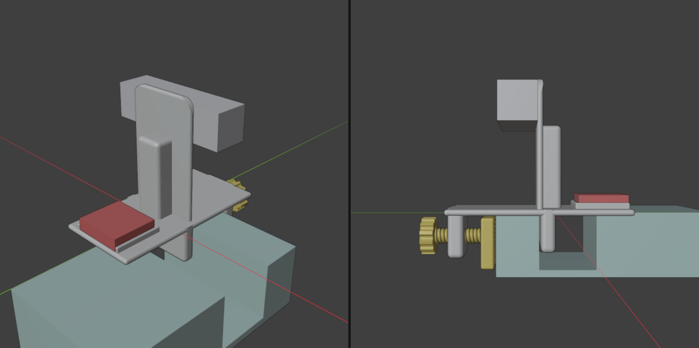
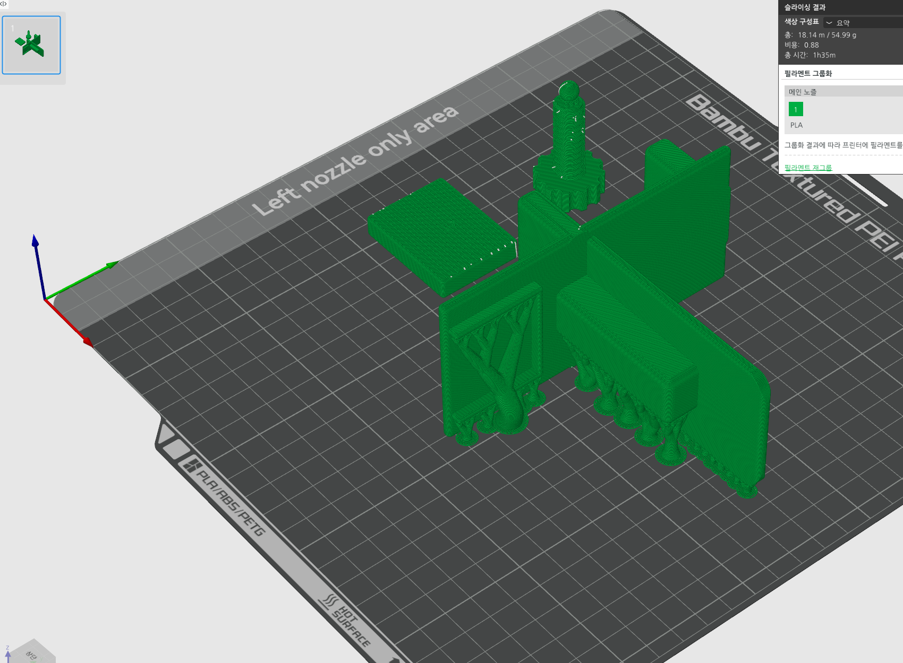

# Trolley Sensor Mount

Intel RealSense **D435** + VectorNav **VN-100 Rugged** mount for the hand-grip pocket at the front rim of a 2-tier plastic utility cart. Three printed parts, all PLA. The only hardware is the M3 screws for the sensors.

## How it holds
1. Drop the plug into the grip pocket so it sits against the inside of the rim.
2. Snap the jaw onto the ball tip of the knob screw, then turn the knob. The jaw presses the outside of the rim and the rim is squeezed between jaw and plug.

Fits rim thickness + gap of about 18–54 mm and a pocket at least 24 mm deep.

## Parts (`print/`, already oriented for printing)
| File | Note |
|---|---|
| `mount_body.stl` | one piece: plate, plug, front arm with threaded hole, D435 plate (2× M3, 45 mm), back column, VN-100 seat (2× M3, 2 dowel holes, open back for the cable). Printed on its side |
| `front_screw.stl` | knob screw with ball tip, printed standing on the knob |
| `front_jaw.stl` | jaw with grip grooves and ball socket |
| `trolley_mount_X2D.3mf` | Bambu Lab X2D project: 0.28 mm, 2 walls, 8 % infill, tree supports under the body only, ~1 h 35 min, 55 g |

Hardware: 2× M3×8 (D435 back), 2× M3×6 (VN-100 from below).

`trolley_mount.blend` is the Blender source. Grey and red boxes are the sensors, not printed parts.

## License
CC BY-NC-SA 4.0
