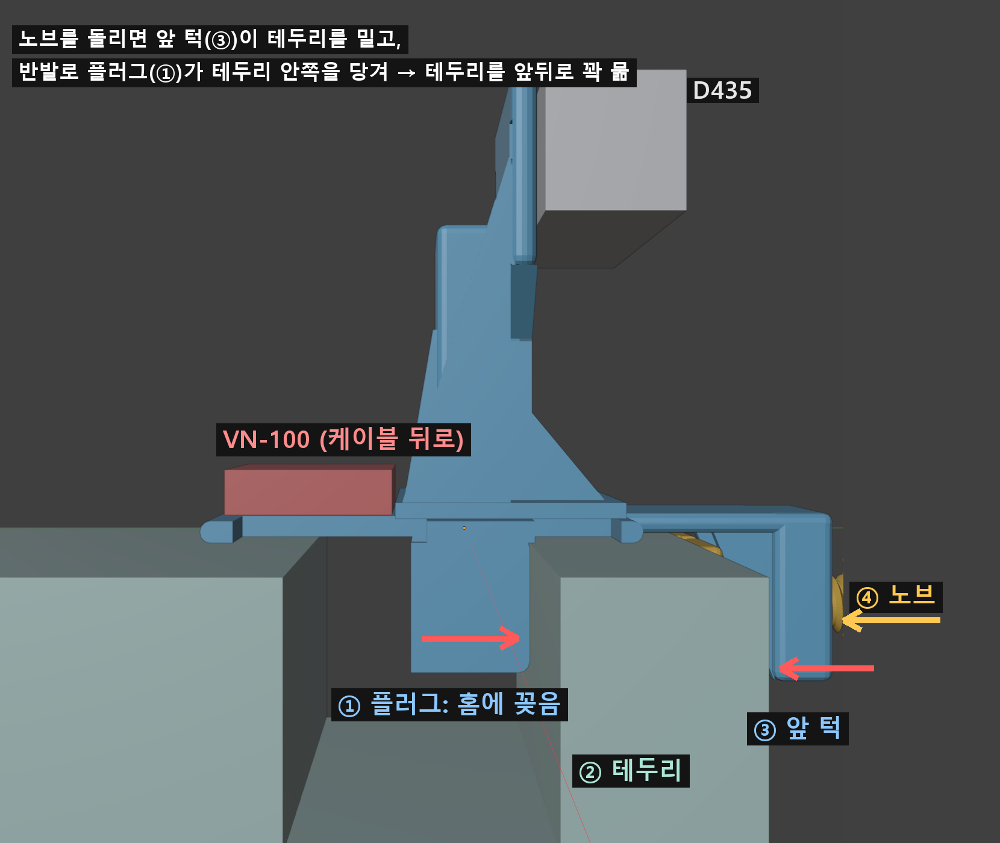
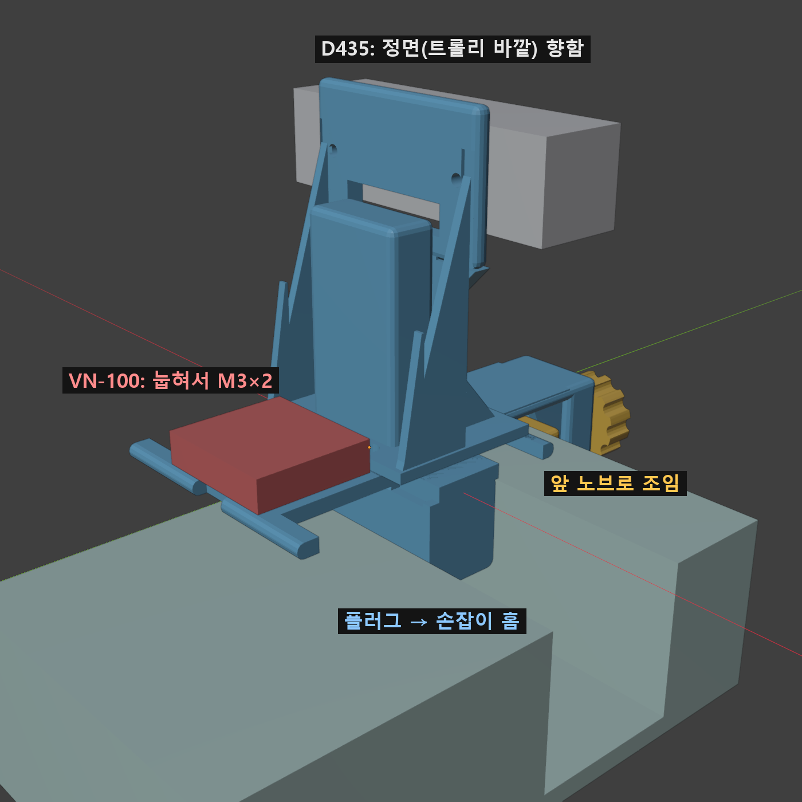

# Trolley Sensor Mount

Intel RealSense **D435** + VectorNav **VN-100 Rugged** mount for the hand-grip pocket at the front rim of a 2-tier plastic utility cart. All parts are 3D printed (PLA, no supports); the only hardware is the M3 screws for the sensors.

## How it holds
1. Drop the plug into the grip pocket and slide it to the tray center.
2. Turn the front knob. The swivel jaw pushes on the outside of the rim, and the plug is pulled against the inside of the rim, so the rim is squeezed front-to-back.

Fits rim thickness + gap of about 18–54 mm and a pocket at least 24 mm deep.

## Parts (`print/`, already oriented for printing)
| File | Note |
|---|---|
| `mount_body.stl` | base: top plate on the bed, plug and knob boss point up |
| `camera_mast.stl` | D435 back plate (2× M3, 45 mm) and gussets |
| `front_jaw.stl` | swivel jaw with grip grooves |
| `front_screw.stl` | knob screw, print standing on the knob |
| `dowel_1–4.stl` | press-fit pins that join the mast to the base |
| `trolley_mount_X2D.3mf` | Bambu Lab X2D, 0.24 mm, 10 % gyroid, ~2 h 23 min |

Hardware: 2× M3×8 (D435 back), 2× M3×6 (VN-100, lies flat on the rear deck, cable exits backward).

`trolley_mount.blend` is the Blender source. Grey and red boxes in the renders are the sensors, not printed parts.

## License
CC BY-NC-SA 4.0
